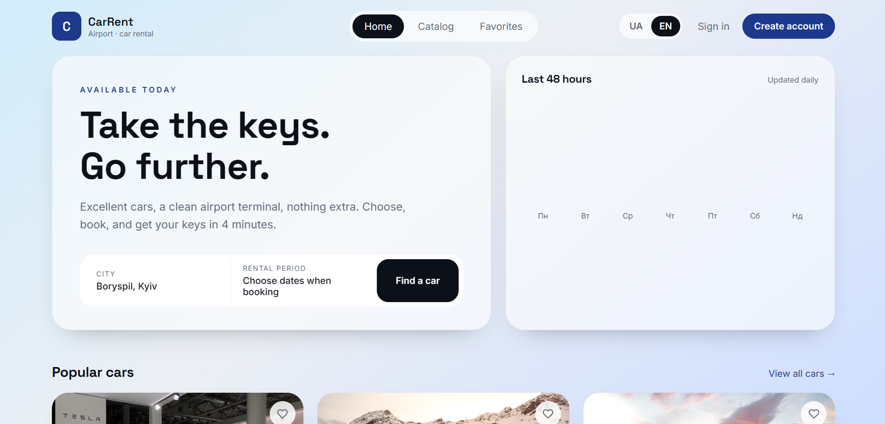
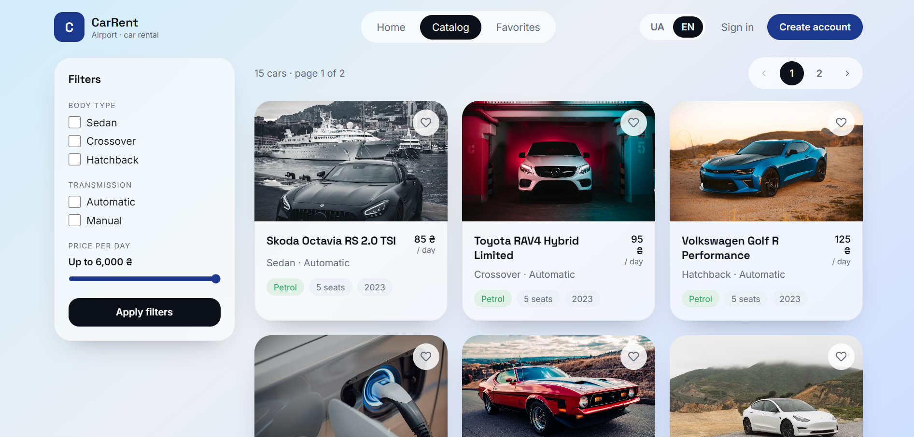
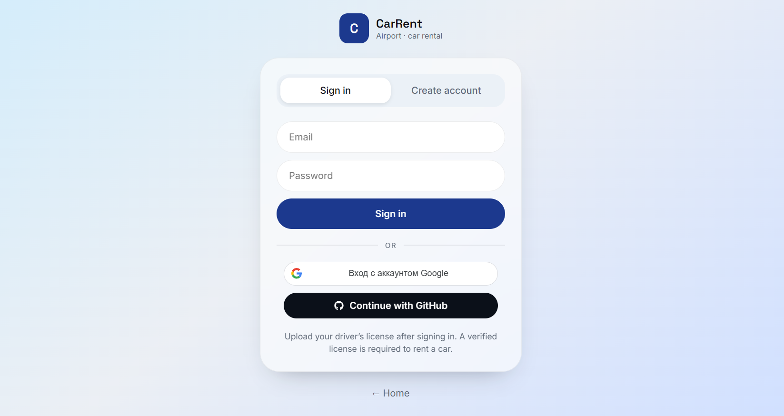

# CarRent

A full-stack car rental application for discovering vehicles, managing bookings, and completing payments online. CarRent combines a React client with a .NET API, SQL Server persistence, Redis-backed favorites, and integrations for Google, GitHub, Cloudinary, and PayPal.

## Screenshots

| Home | Car catalog | Sign in |
| --- | --- | --- |
|  |  |  |

## Features

- Browse and filter a paginated catalog by vehicle attributes, with car detail views and popular cars.
- Register or sign in with email and password, Google, or GitHub.
- Issue JWT access tokens and rotate or revoke refresh tokens.
- Create, view, and cancel bookings; pending booking expiration is handled by a background service.
- Pay for bookings through PayPal, with payment confirmation processed through PayPal webhooks.
- Save and remove favorite cars stored in Redis.
- Submit a driver-license number and image. The current verifier checks number format; it does not check a government registry.
- Upload car and license images through Cloudinary when configured.
- View booking statistics and use role-aware vehicle and booking operations.
- Switch the interface between English and Ukrainian.

## Technology

| Area | Stack |
| --- | --- |
| Frontend | React 19, TypeScript, Vite, Redux Toolkit, React Router, Axios, i18next |
| API | ASP.NET Core / .NET 10, C#, MediatR, FluentValidation, AutoMapper |
| Data | Entity Framework Core, SQL Server, Redis |
| Integrations | Google OAuth, GitHub OAuth, PayPal, Cloudinary |
| Delivery | Docker, Docker Compose, Nginx |
| Tests | xUnit, Moq, FluentAssertions, ASP.NET Core integration testing, SQL Server Testcontainers |

## Architecture

The backend separates domain entities, application use cases, infrastructure adapters, and the HTTP API. The React frontend calls the API over HTTP. SQL Server stores application data; Redis stores favorite-car sets. External providers handle identity, image storage, and PayPal checkout.

[View the system architecture diagram](docs/architecture.md)

Additional diagrams:

- [Data model (ER diagram)](docs/data-model.md)
- [Authentication flow](docs/authentication-flow.md)
- [Booking and PayPal payment flow](docs/booking-payment-flow.md)

## Authentication

CarRent supports three sign-in methods:

- **Email and password** are handled by ASP.NET Core Identity.
- **Google** sign-in sends a Google ID token from the client to the API for provider validation.
- **GitHub** sign-in uses the GitHub OAuth authorization-code flow. The API exchanges the code with GitHub and obtains the user's profile.

After successful authentication, the API returns a JWT access token and a persisted refresh token. Refresh requests rotate active refresh tokens; logout revokes the submitted token. The frontend uses the access token for authenticated API requests.

See the [authentication flow](docs/authentication-flow.md) and [local OAuth setup](DOCKER.md#oauth-local-setup).

## Booking and payments

Authenticated users can create bookings for a car and date range. A booking starts pending. The client requests a PayPal order for the booking, the user approves it at PayPal, and CarRent reconciles the result through the PayPal webhook. The client can poll the booking payment-status endpoint after returning from PayPal.

See the [booking and payment flow](docs/booking-payment-flow.md).

## Getting started with Docker

### Prerequisites

- Docker Desktop with Docker Compose
- OAuth and PayPal credentials only if you want to use those integrations

### Run

1. Clone the repository and change to its root directory.
2. Copy .env.example to .env.
3. Set credentials for the integrations you want to enable.
4. Start the application:

~~~bash
docker compose up --build
~~~

Open the frontend at [http://localhost:3000](http://localhost:3000). The API is at [http://localhost:8080](http://localhost:8080), with Swagger UI at [http://localhost:8080/swagger](http://localhost:8080/swagger) in Development.

Compose starts SQL Server and Redis, waits for their health checks, then starts the API and frontend. The Compose configuration enables EF Core migrations at API startup and runs registered seeders. Database and Redis data persist in Docker volumes. Read [DOCKER.md](DOCKER.md) for OAuth callback setup, configuration details, and volume behavior.

### Configuration

.env.example lists the supported Docker environment variables. Key settings include:

| Variable | Purpose |
| --- | --- |
| MSSQL_SA_PASSWORD | Local SQL Server administrator password |
| JWT_SECRET_KEY, JWT_ISSUER, JWT_AUDIENCE | JWT signing and validation settings |
| GOOGLE_CLIENT_ID | Google client ID used by the frontend and API |
| GITHUB_CLIENT_ID, GITHUB_CLIENT_SECRET, GITHUB_REDIRECT_URI | GitHub OAuth app configuration |
| PAYPAL_CLIENT_ID, PAYPAL_CLIENT_SECRET, PAYPAL_BASE_URL | PayPal checkout integration; sample URL targets PayPal Sandbox |
| PAYPAL_WEBHOOK_ID | PayPal webhook verification configuration |
| CLOUDINARY_CLOUD_NAME, CLOUDINARY_API_KEY, CLOUDINARY_API_SECRET | Cloudinary image uploads |
| VITE_API_URL | API base URL built into the frontend |

The checked-in values are local-development defaults. Replace the SQL password and JWT signing key before sharing the stack or deploying it. Keep provider secrets in API-side environment variables; values prefixed with VITE_ are exposed to the browser bundle.

## Testing

The tests/CarRent.Tests project contains unit tests for validators, mappings, authentication, bookings, cars, favorites, and PayPal handlers, plus API integration tests using SQL Server Testcontainers.

Run the suite from the repository root:

~~~bash
dotnet test CarRent.slnx
~~~

Frontend scripts are defined in frontend/package.json:

~~~bash
cd frontend
npm ci
npm run lint
npm run build
~~~

## Repository layout

~~~text
.
├── docs/                    # Screenshots and architecture diagrams
├── frontend/                # React + TypeScript client
├── src/
│   ├── CarRent.Api/          # ASP.NET Core controllers and startup
│   ├── CarRent.Application/  # Use cases, validation, and abstractions
│   ├── CarRent.Domain/       # Core entities and enums
│   └── CarRent.Infrastructure/ # EF Core, identity, Redis, and providers
├── tests/CarRent.Tests/      # Unit and integration tests
├── docker-compose.yml
├── Dockerfile
├── DOCKER.md
└── CarRent.slnx
~~~

## Documentation

- [System architecture](docs/architecture.md)
- [Data model](docs/data-model.md)
- [Authentication flow](docs/authentication-flow.md)
- [Booking and payment flow](docs/booking-payment-flow.md)
- [Docker and local configuration](DOCKER.md)

## License

This project is distributed under the [MIT License](LICENSE).

